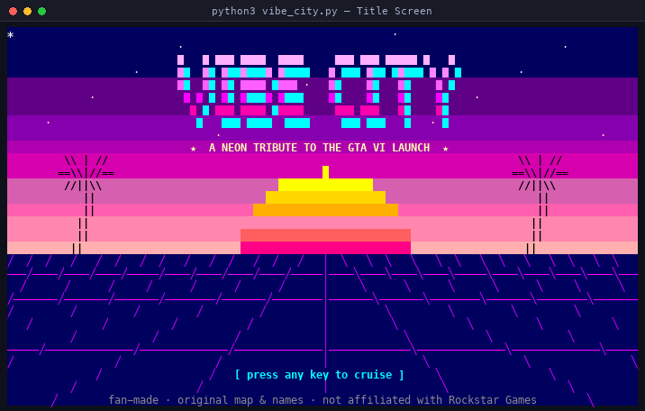
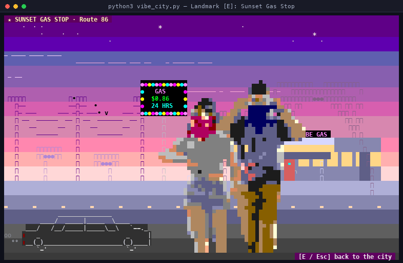

<div align="center">

# 🌴 VIBE CITY 🌴

**A living neon coastal city inside your terminal — complete with dynamic day/night cycles, 90 cruising cars, 5 original procedurally-synthesized radio stations, enterable animated landmarks, and an unlisted hidden treasure.**

[](https://www.python.org/)
[](#quick-start)
[](#in-game-synth-radio)
[](#disclaimer)

<br />



</div>

---

## ✨ Six Lanes of Sunset — *A Short Story*

> *The clock on the dashboard turns **18:30**. Out over **The Big Blue**, the turquoise shallows along **Neon Shores** begin to bleed into deep midnight navy.*
>
> *A warm salt breeze rattles the palm fronds down Ocean Drive as the pastel Art Deco hotels wake up one window at a time—pink, seafoam, amber, violet. Somewhere across **Vibe Bay**, **Chrome Heights** lights up its glass towers while headlights stream in quiet ribbons over the four bridges linking the mainland to the barrier island.*
>
> *You tune the dial to **NEON WAVE 88.6**. A gated snare hits, a warm sawtooth bassline rolls underneath, and you point the hood west onto **Vibe Causeway**. Past the sandy rings of **Flamingo Keys** and the golf fairways suspended over the water, the city opens up: the glowing shipping containers of **Starlight Docks**, the crossed runways of **Vibe Int'l Airport**, the quiet canals of **Mango Gardens**.*
>
> *Out on **Route 86**, beneath a flickering **`$0.86 · 24 HRS`** neon sign, a dark muscle car idles in the purple sunset haze. Two silhouettes stand on the asphalt in front of the pumps—crimson bandana, navy bandana, eyes fixed straight ahead—watching a jet contrail dissolve into the dusk.*
>
> *Cruise long enough and you'll hear one more rumor drifting between radio tracks: somewhere in this city lies a **hidden treasure**—unmarked, unannounced, and waiting for whoever stumbles upon it.*

---

## 🚗 Cruising the Archipelago

<div align="center">


*Cruising Ocean Drive on **Neon Shores** and crossing **Vibe Causeway** past **Flamingo Keys** at dusk.*

</div>

---

## 🗺️ Living World & Full-City Day/Night Cycle

<div align="center">


*Press **`M`** for the full-city tactical map and **`T`** to jump forward 2 hours toward sunrise or sunset.*

</div>

---

## ★ Enterable Animated Landmarks

<div align="center">



*Interactive scenes: **Sunset Gas Stop**, **Sunset Pier**, **Club 86 Rooftop**, and **Pink Flamingo Motel** (plus **Runway 86** & **Crane Row**).*

</div>

---

## 🌟 Features & Details

- **Handcrafted `180 × 60` Coastal Archipelago**: Organic coastlines with distance-based coastal bathymetry (shallow turquoise **Vibe Bay** hugging every shoreline before dropping into rolling deep-navy **The Big Blue**), continuous golden beaches, palm groves, a winding canal through **Mango Gardens**, three central bay island chains (Prawn Island, the three connected Leaf Links golf islands, and Starfish Island), four east–west bridges, crossed X-shaped airport runways, and three protruding harbor piers at **Starlight Docks**.
- **Real-Time 24-Hour Day/Night Cycle**: The city opens at `16:00` (4 game minutes per real second, so a full day takes 6 minutes and your first sunset arrives ~40 seconds in). Ocean waters, beaches, grass, glass towers, and roads smoothly blend across **Dawn**, **Day**, **Dusk**, and **Night**. Neon signs switch off during daylight and flicker alive after dusk, while skyscraper and hotel windows light up dynamically—peaking around `02:00` before people head to sleep by `05:00`.
- **90 Autonomous AI Vehicles**: Colorful traffic (`▶ ▼ ◀ ▲`) cruises continuously across expressways, avenues, and all four bridges in real time.
- **6 Enterable Animated Landmarks**: Walk within 2 tiles of any flashing **`★`** landmark and press **`E`** to open a full-screen live animated scene:
  - **Sunset Gas Stop** (*Route 86*) — Foreground duo in half-block pixel art, idling muscle car with blinking taillights & exhaust puffs, chasing **`$0.86 GAS`** neon sign, power lines with birds, drifting pink clouds, and a passing jet with contrail.
  - **Sunset Pier** (*Neon Shores*) — Striped synthwave sun setting over glittering waves, passing sailboat, flying gulls, and flickering pier lanterns.
  - **Pink Flamingo Motel** (*Neon Shores*) — Pastel two-story motel, flashing **`NO VACANCY`** neon marquee, parked cruiser, and shimmering neon reflections on wet asphalt.
  - **Club 86 Rooftop** (*Chrome Heights*) — Sweeping skyline searchlights, blinking radio towers, a passing helicopter, and an animated rooftop dance floor.
  - **Runway 86** (*Vibe Int'l Airport*) — Perspective runway with rushing edge lights and jets taking off every 7 seconds.
  - **Crane Row** (*Starlight Docks*) — Sweeping lighthouse beam, moonlit harbor, working gantry cranes swinging containers, and passing cargo ships.
- **13 Distinct Districts & Vibes Meter**: Every region tracks its own live **Vibes** rating (`▮▮▮▮▮`) and pops a neon toast banner whenever you cross into a new neighborhood.
- **Built-In Procedural Synth Radio**: 5 original stations (15 tracks) synthesized from scratch in [`radio.py`](radio.py) using NumPy oscillators, procedural drums, stereo ping-pong echo, and seeded chord progressions—played seamlessly in a single-worker background thread with zero audio overlap when switching stations or tracks.
- **Zero-Dependency Core & Adaptive Terminal Rendering**: Runs on the Python standard library alone (`curses`), dynamically manages 256-color pairs (with automatic 16-color down-mapping), adapts smoothly to live terminal resizes, and includes a full `--ascii` glyph fallback mode.
- **🏆 Hidden Treasure**: There is a secret, unlisted hidden treasure tucked somewhere in Vibe City. No spoilers, no blinking markers, and no hints—happy hunting!

---

## 🚀 Quick Start

```bash
git clone https://github.com/erdemozkan/Vibe-City.git
cd Vibe-City
python3 vibe_city.py
```

### Launch Options
| Command | Description |
| :--- | :--- |
| `python3 vibe_city.py` | Launch with 256-color Unicode graphics + live synth radio |
| `python3 vibe_city.py --ascii` | Pure ASCII fallback mode if your terminal font mangles Unicode glyphs |
| `python3 vibe_city.py --mute` | Launch without background radio audio |
| `VIBE_VOLUME=0.4 python3 vibe_city.py` | Adjust radio playback volume (`0.0` – `1.0`, default `0.6`) |

### Requirements
- **Core game**: Python 3.8+ standard library only (`curses`, `math`, `random`, `zlib`, `base64`).
- **Built-in synth radio** *(optional)*: `numpy` + macOS `afplay` (uses built-in `afconvert` to cache compressed `.m4a` loops inside `./radio/`). If either is unavailable, the game runs cleanly in silent mode.

---

## 🎮 Controls

| Key | Action |
| :--- | :--- |
| `↑` `↓` `←` `→` / `W` `A` `S` `D` | Cruise around the city |
| `TAB` | Toggle **Sprint** (3× movement speed) |
| `E` / `Enter` | Enter a nearby **`★`** landmark (or return to the city) |
| `M` | Toggle full-city map view |
| `G` | Toggle **Ghost Mode** (pass freely over water & rooftops) |
| `T` | Skip ahead 2 hours (jump straight to sunrise or sunset) |
| `R` | Next radio station |
| `N` | Next song on the current station |
| `V` | Mute / unmute radio audio |
| `?` / `H` | Toggle in-game help overlay |
| `Esc` | Close active scene, map view, or help box |
| `Q` | Quit cleanly (stops radio playback automatically) |

---

## 💡 Tips & Tricks

- **Best window size**: Aim for at least **`120 × 40`** for roomy cruising—or maximize your terminal to **`180 × 62`** to take in the entire archipelago at native 1:1 scale without scrolling.
- **Instant golden hour or midnight**: Tap **`T`** to jump ahead 2 hours anytime—hit **`18:30–19:30`** for sunset dusk, **`02:00`** for peak lit skyline windows, or **`12:00`** for bright turquoise tropical waters.
- **Cruise while zoomed out**: You can still drive around in full-city Map Mode (**`M`**)—your glowing neon marker pulses so you can plot long bridge crossings across the whole bay.
- **Sprint + Ghost Mode**: Combine **`TAB`** (3× speed) with **`G`** (Ghost Mode) to glide effortlessly across open water and high-rise rooftops. If you turn Ghost Mode off while over water or a solid building, the city safely teleports you back to spawn so you never get stuck.
- **Radio stays live everywhere**: **`R`** (station), **`N`** (next song), and **`V`** (mute/unmute) work even while hanging out inside animated landmark scenes.
- **Fast restarts**: On first launch, `radio.py` synthesizes the first track of every station first (so switching stations with **`R`** is immediate) and caches all 15 loops in `./radio/`. Every launch after that starts playing instantly.
- **Chill coding soundtrack**: Run `VIBE_VOLUME=0.25 python3 vibe_city.py`, park at **Sunset Pier** or **Sunset Gas Stop**, and leave it running in a side terminal pane as an animated synthwave desktop screensaver.
- **Font glitches?**: If palms, cars, or borders look misaligned in your terminal font, launch with `python3 vibe_city.py --ascii` for crisp pure-ASCII rendering.

---

## 📻 In-Game Synth Radio

All **5 radio stations (15 original songs)** in [`radio.py`](radio.py) are synthesized completely from scratch—no samples, no external audio files:

| Station | Style & Tempo | Tracks |
| :--- | :--- | :--- |
| **NEON WAVE 88.6** | Synthwave · 100 BPM | *Midnight Palms*, *Chrome Horizon*, *Afterglow Drive* |
| **FLAMINGO FM** | Disco · 118 BPM | *Pastel Suits*, *Velvet Rollerdisco*, *Mirrorball Heart* |
| **CHROME RADIO** | Dark Synth · 92 BPM | *Heat Mirage*, *Steel Rain*, *Overpass* |
| **BAYSIDE SOUL** | Chill Soul · 78 BPM | *Low Tide Love*, *Porch Light*, *Salt & Honey* |
| **STATIC 103** | Chiptune · 140 BPM | *Six Lanes of Sunset*, *Pixel Coast*, *Insert Coin Boulevard* |

---

## 🏙️ Districts & Landmarks

| District | Vibes | Tagline | Landmarks |
| :--- | :---: | :--- | :--- |
| **Neon Shores** | `▮▮▮▮▮` | *pastel hotels, all-night surf* | ★ Sunset Pier · ★ Pink Flamingo Motel |
| **Flamingo Keys** | `▮▮▮▮▮` | *tiny islands, big money* | Prawn, Leaf Links Golf Islands & Starfish Island |
| **Chrome Heights** | `▮▮▮▮▯` | *glass towers, neon rooftops* | ★ Club 86 Rooftop |
| **Vibe Causeway** | `▮▮▮▮▯` | *six lanes of sunset* | Central bay bridge crossing |
| **Vibe Bay** | `▮▮▮▮▯` | *yachts, jet skis, bad decisions* | Turquoise shallows & four bridges |
| **The Big Blue** | `▮▮▮▮▯` | *nothing but horizon* | Animated open ocean |
| **Palmetto Downs** | `▮▮▮▯▯` | *lawns, palms, suspicious BBQs* | Suburban grid |
| **Mango Gardens** | `▮▮▮▯▯` | *canals, gators, mango trees* | Winding canal & palm groves |
| **Route 86** | `▮▮▮▯▯` | *the long way to the beach* | ★ Sunset Gas Stop |
| **I-Vibe Expressway** | `▮▮▮▯▯` | *never not under construction* | North–south mainland highway |
| **Starlight Channel** | `▮▮▮▯▯` | *cargo ships at dusk* | Southern harbor crossing |
| **Vibe Int'l Airport** | `▮▮▯▯▯` | *now boarding: everyone* | ★ Runway 86 (X-shaped runways) |
| **Starlight Docks** | `▮▮▯▯▯` | *containers full of who-knows* | ★ Crane Row & three harbor piers |

---

## 📝 Disclaimer

Vibe City is a fan-made terminal tribute celebrating the GTA VI launch. All code, procedural radio tracks, terminal scenes, and district names are original fan works; this project is not affiliated with or endorsed by Rockstar Games or Take-Two Interactive.
