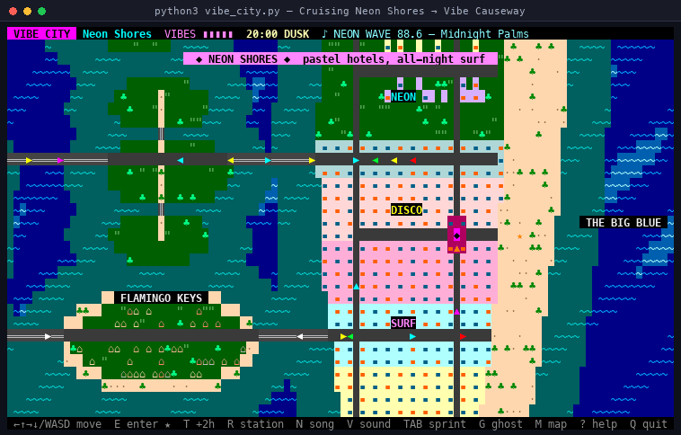
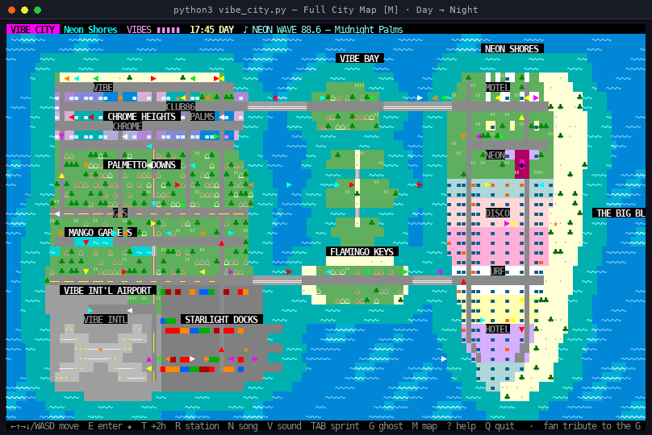

<div align="center">

# 🌴 VIBE CITY 🌴

**A living neon coastal city inside your terminal — complete with day/night cycles, 90 cruising cars, 5 original synthwave radio stations, enterable animated landmarks, and a Ghost-Mode secret.**

[](https://www.python.org/)
[](#quick-start)
[](#in-game-synth-radio)
[](#disclaimer)

<br />


</div>

---

## ✨ Six Lanes of Sunset — *A Short Story*

> *The clock on the dashboard turns **18:30**. Out over **The Big Blue**, the turquoise shallows along **Neon Shores** begin to bleed into deep midnight navy.*
>
> *A warm salt breeze rattles the palm fronds down Ocean Drive as the pastel Art Deco hotels wake up one window at a time—pink, seafoam, amber, violet. Somewhere across **Vibe Bay**, **Chrome Heights** lights up its glass towers while headlights stream in quiet ribbons over the four bridges linking the mainland to the barrier island.*
>
> *You tune the dial to **NEON WAVE 88.6**. A gated snare hits, a warm sawtooth bassline rolls underneath, and you point the hood west onto **Vibe Causeway**. Past the sandy rings of **Flamingo Keys** and the golf fairways suspended over the water, the city opens up: the glowing shipping containers of **Starlight Docks**, the crossed runways of **Vibe Int'l Airport**, the quiet canals of **Mango Gardens**.*
>
> *Out on **Route 86**, beneath a flickering **`$0.86 · 24 HRS`** neon sign, a dark muscle car idles in the purple sunset haze. Two silhouettes stand on the asphalt in front of the pumps—crimson bandana, navy bandana, eyes fixed straight ahead—watching a jet contrail dissolve into the dusk.*
>
> *Drive long enough and the locals will tell you one more rumor: when the night gets late and the neon signs start to hum, switch into **Ghost Mode** and drift through the pastel walls of **Neon Shores**. They say there is no blinking star to guide you—only something hidden quietly beneath the glowing letters of **`HOTEL`** for those curious enough to look.*

---

## 🚗 Cruising the Archipelago

Explore a handcrafted `180 × 60` coastal archipelago inspired by classic 1986 Vice City geography—featuring organic coastlines, turquoise coastal bathymetry, continuous golden beaches, three central bay island chains, four east–west bridges, crossed airport runways, and protruding harbor piers.

<div align="center">



*Cruising Ocean Drive on **Neon Shores** and crossing **Vibe Causeway** past **Flamingo Keys** at dusk.*

</div>

---

## 🗺️ Living World & Full-City Day/Night Cycle

Press **`M`** at any time to zoom out to the live satellite view of the entire city. Watch a full 24-hour cycle unfold (**Dawn → Day → Dusk → Night**) as ocean hues shift from sunny turquoise to deep navy, neon signs flicker alive after sunset, tower windows gradually light up until 02:00, and 90 AI cars weave across every highway and bridge.

<div align="center">



*Press **`M`** for the full-city tactical map and **`T`** to jump forward 2 hours toward sunrise or sunset.*

</div>

---

## ★ Enterable Animated Landmarks

Walk within 2 tiles of any flashing **`★`** landmark and press **`E`** to step into a full-screen animated terminal scene—from the sunset duo outside **Sunset Gas Stop**, to sailboats gliding across **Sunset Pier**, sweeping searchlights above **Club 86 Rooftop**, and neon reflections on the wet asphalt of **Pink Flamingo Motel**.

<div align="center">


*Interactive scenes: **Sunset Gas Stop**, **Sunset Pier**, **Club 86 Rooftop**, and **Pink Flamingo Motel** (plus **Runway 86** & **Crane Row**).*

</div>

### 👻 Rumor of a Hidden Treasure
> *Not every landmark announces itself with a blinking **`★`**. Activate **Ghost Mode (`G`)** and explore inside the solid blocks of **Neon Shores**—somewhere right beneath the neon **`HOTEL`** sign hides an unlisted native ASCII fan-art piece.*

---

## 🚀 Quick Start

```bash
git clone https://github.com/erdemozkan/Vibe-City.git
cd Vibe-City
python3 vibe_city.py
```

### Options
| Command | Description |
| :--- | :--- |
| `python3 vibe_city.py` | Launch with 256-color Unicode graphics + live synth radio (recommended: `120×40` or larger terminal) |
| `python3 vibe_city.py --ascii` | Pure ASCII fallback mode if your terminal font doesn't align Unicode glyphs |
| `python3 vibe_city.py --mute` | Launch without background radio audio |
| `VIBE_VOLUME=0.4 python3 vibe_city.py` | Adjust radio playback volume (`0.0` – `1.0`, default `0.6`) |

### Requirements
- **Core game**: Python 3.8+ standard library only (`curses`, `math`, `random`, `zlib`) — zero external packages required.
- **Built-in synth radio** *(optional)*: `numpy` + macOS `afplay` (`afconvert` compresses cached loops into `./radio/` automatically). If unavailable, the game runs cleanly in silent mode.

---

## 🎮 Controls

| Key | Action |
| :--- | :--- |
| `↑` `↓` `←` `→` / `W` `A` `S` `D` | Cruise around the city |
| `TAB` | Toggle **Sprint** (3× movement speed) |
| `E` / `Enter` | Enter a nearby **`★`** landmark (or exit a scene) |
| `M` | Toggle full-city map view |
| `G` | Toggle **Ghost Mode** (pass over water & rooftops) |
| `T` | Skip ahead 2 hours (jump straight to sunrise or sunset) |
| `R` | Next radio station |
| `N` | Next song on the current station |
| `V` | Mute / unmute radio audio |
| `?` / `H` | Toggle in-game help overlay |
| `Esc` | Close scene / map / help |
| `Q` | Quit |

---

## 📻 In-Game Synth Radio

All **5 radio stations (15 original songs)** in [`radio.py`](radio.py) are synthesized completely from scratch in Python + NumPy—procedural drums, saw/square/pulse oscillators, stereo ping-pong echo, and seeded chord progressions—cached locally on first run:

| Station | Vibe | Tracks |
| :--- | :--- | :--- |
| **NEON WAVE 88.6** | Synthwave · 100 BPM | *Midnight Palms*, *Chrome Horizon*, *Afterglow Drive* |
| **FLAMINGO FM** | Disco · 118 BPM | *Pastel Suits*, *Velvet Rollerdisco*, *Mirrorball Heart* |
| **CHROME RADIO** | Dark Synth · 92 BPM | *Heat Mirage*, *Steel Rain*, *Overpass* |
| **BAYSIDE SOUL** | Chill Soul · 78 BPM | *Low Tide Love*, *Porch Light*, *Salt & Honey* |
| **STATIC 103** | Chiptune · 140 BPM | *Six Lanes of Sunset*, *Pixel Coast*, *Insert Coin Boulevard* |

---

## 🏙️ Districts & Landmarks

| District | Vibes | Tagline | Landmarks |
| :--- | :---: | :--- | :--- |
| **Neon Shores** | `▮▮▮▮▮` | *pastel hotels, all-night surf* | ★ Sunset Pier · ★ Pink Flamingo Motel · *(👻 hidden secret)* |
| **Flamingo Keys** | `▮▮▮▮▮` | *tiny islands, big money* | Prawn, Leaf Links Golf Islands & Starfish Island |
| **Chrome Heights** | `▮▮▮▮▯` | *glass towers, neon rooftops* | ★ Club 86 Rooftop |
| **Vibe Causeway** | `▮▮▮▮▯` | *six lanes of sunset* | Central bay bridge crossing |
| **Vibe Bay** | `▮▮▮▮▯` | *yachts, jet skis, bad decisions* | Turquoise shallows & four bridges |
| **The Big Blue** | `▮▮▮▮▯` | *nothing but horizon* | Animated open ocean |
| **Palmetto Downs** | `▮▮▮▯▯` | *lawns, palms, suspicious BBQs* | Suburban grid |
| **Mango Gardens** | `▮▮▮▯▯` | *canals, gators, mango trees* | Winding canal & palm groves |
| **Route 86** | `▮▮▮▯▯` | *the long way to the beach* | ★ Sunset Gas Stop |
| **I-Vibe Expressway** | `▮▮▮▯▯` | *never not under construction* | North–south mainland highway |
| **Starlight Channel** | `▮▮▮▯▯` | *cargo ships at dusk* | Southern harbor crossing |
| **Vibe Int'l Airport** | `▮▮▯▯▯` | *now boarding: everyone* | ★ Runway 86 (X-shaped runways) |
| **Starlight Docks** | `▮▮▯▯▯` | *containers full of who-knows* | ★ Crane Row & three harbor piers |

---

## 📝 Disclaimer

Vibe City is a fan-made terminal tribute celebrating the GTA VI launch. All code, procedural radio tracks, terminal scenes, and district names are original fan works; this project is not affiliated with or endorsed by Rockstar Games or Take-Two Interactive.
